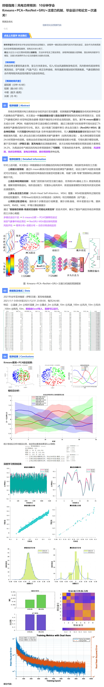

# Ultimate Guide | Wind Power Forecasting: Learn K-means + PCA + ResNet + GRU + Attention Mechanism in 10 Minutes! Graduate Design and Thesis Pass with One Go!

\n        \n  
% Read the original dataset\nrawData = xlsread('Wind power category1Data.xlsx');  % Read category 1 data\n                        \n%% Data Set Analysis Module\ntrainRatio = 0.9897;                % 98.97% of the training set is divided (exactly calculated to keep the last 24 hours as the test set)\noutputColIndex = 1;                 % Define the output column position index (assuming the last column is the target power value)\ntotalSamples = size(rawData, 1);    % Calculate the total sample size (number of rows in the matrix)\nfeatureDim = size(rawData, 2) - outputColIndex - 1;  % Feature dimension = Total number of columns - output columns - clustering labels column\n                                    % Assuming the first N-1-1 columns are features, and the second to last column is the prediction target.\n%% Data Preprocessing Module\n% Data randomization processing (to prevent the original data's orderliness from affecting model learning)\nshuffledIdx = randperm(totalSamples);             % Generate a random permutation of indices (1~N)\nrawData = rawData(shuffledIdx, :);                % Rearrange the data matrix according to a random index\ntrainSamples = round(trainRatio * totalSamples);  % Rounding to the nearest integer for training sample count\n                       \n%% Dataset Division Module\n% Input features and target variables are separated.\n% Training set division\ninputTrain = rawData(1:trainSamples, 1:featureDim)';      % Extract the feature columns from the first trainSamples rows\n                                                          % Transpose to [feature count × sample count] format\n                                                          % Complies with MATLAB Deep Learning Framework input requirements\ntargetTrain = rawData(1:trainSamples, end-1)';            % Extract the second to last column as the prediction target and transpose it\n% Test set division\ninputTest = rawData(trainSamples+1:end, 1:featureDim)';   % Remaining samples as test set\ntargetTest = rawData(trainSamples+1:end, end-1)';         % Test set target values\n% Get dataset size information\ntrainSize = size(inputTrain, 2);   % Number of training samples (number of columns in the matrix)\ntestSize = size(inputTest, 2);     % Number of test samples\n%% Data Standardization Module\n% Input feature normalization processing (mapped to the [-1,1] interval)\n[inputTrainNorm, inputNormParams] = mapminmax(inputTrain, -1, 1); \n                        % Normalize the training set and save normalized parameters (minimum, maximum, etc.)\n                        % Linear transformation: y = 2*(x-xmin)/(xmax-xmin) - 1\ninputTestNorm = mapminmax('apply', inputTest, inputNormParams); \n                        % The test set uses the training set parameters for normalization to prevent data leakage.\n                        % Key Point: The test set does not participate in any parameter calculation.\n  

## Images

<!-- PAYMENT_BLOCK -->

## Get this dataset

- Payment link (Stripe): [Buy now](https://buy.stripe.com/3cs8yP7sY87d0vu9AB)
- Payment QR code: 

<!-- /PAYMENT_BLOCK -->
